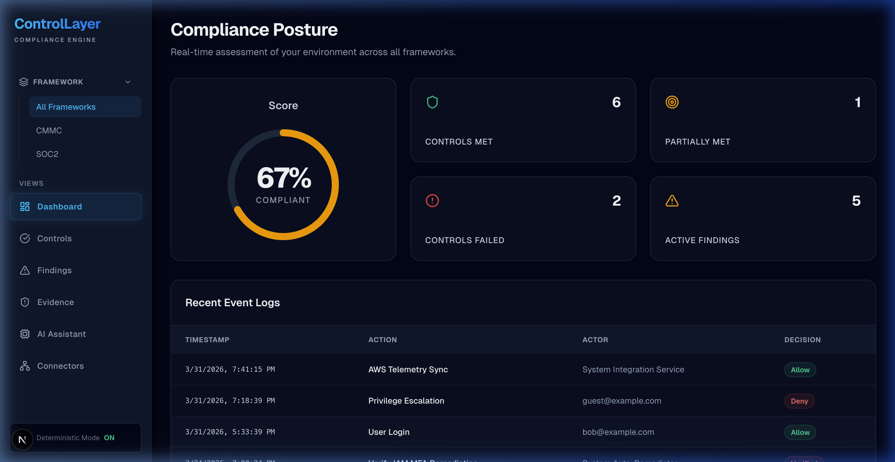

# 🚀 Agentic AI SaaS Report

## 1. Executive Summary

**ControlLayer** is a production-ready, deterministic compliance engine and Agentic AI SaaS designed to automate, evaluate, and enforce cybersecurity frameworks like CMMC and SOC2. By integrating directly with cloud environments (e.g., AWS) and employing an assistive Agentic AI, ControlLayer transforms static compliance checklists into real-time, continuously monitored security postures.

**Core Purpose:** To provide organizations with a real-time, evidence-based compliance posture that bridges the gap between technical reality and governance requirements.

**Target Users:**
- Chief Information Security Officers (CISOs)
- Compliance Officers and Auditors
- Security Engineers and DevOps Teams
- Managed Service Providers (MSPs)

**Key Differentiators:**
- **Deterministic Evaluation:** Unlike purely generative AI tools that hallucinate compliance status, ControlLayer's assessment engine is deterministic, relying on hard event logs and evidence artifacts.
- **Assistive AI Constraints:** The built-in AI assistant operates strictly in an assistive mode (generating System Security Plan (SSP) narratives and Plan of Action and Milestones (POA&M) matrices) without the ability to autonomously mutate production state or configurations.
- **Real-Time Integration:** Direct ingestion of AWS infrastructure state and logs to calculate continuous compliance scores.

**Why it matters in the age of Agentic AI:**
As enterprises accelerate adoption of Agentic features, the risk of non-compliant autonomous actions skyrockets. ControlLayer provides the necessary "control plane" to monitor not just human actors, but also other AI agents, ensuring that all operations adhere strictly to CMMC and SOC2 mandates without sacrificing operational agility.

---

## 2. Problem Statement

### The Problem
Organizations face an immense operational burden in demonstrating and maintaining compliance with stringent frameworks like CMMC 2.0 and SOC2. Existing solutions are often manual, backward-looking (snapshot audits), and disconnected from the actual technical reality of cloud environments.

### Why Existing Solutions Fail
- **Static Spreadsheets:** Compliance is largely managed in Excel or GRC platforms that require manual evidence mapping.
- **"Black Box" AI Security Risks:** Emerging AI security tools often lack deterministic accountability, leading to hallucinated compliance statuses or "oversight by proxy" where the AI misses critical misconfigurations.
- **Lagging Indicators:** Traditional audits tell you if you *were* secure three months ago, not if you are secure *today*.

### Risks of Not Solving This Problem
- Failure to achieve CMMC validation, resulting in the inability to bid on or maintain Department of Defense (DoD) contracts.
- Severe regulatory fines and loss of client trust due to SOC2 breaches.
- Inability to securely scale Agentic AI deployments within the enterprise due to a lack of observable compliance guardrails.

### Industry Context
With the DoD's CMMC rollout and the rapid proliferation of autonomous systems, organizations must prove *continuous* compliance. Security teams are overwhelmed, and traditional point-in-time auditing is obsolete.

---

## 3. Solution Overview

ControlLayer is an end-to-end platform that sits between an organization's cloud infrastructure and its governance teams. It automatically ingests telemetry, evaluates it against active policies, and provides a conversational AI interface for reasoning over the security posture.

### Key Capabilities
- **Continuous Assessment:** Automatically evaluates event logs and evidence artifacts against predefined CMMC/SOC2 controls.
- **Deterministic Scoring:** Uses hard logic to determine if a control is 'Met', 'Not Met', or 'Partial'.
- **Assistive Remediation AI:** Context-aware LLM integration that explains *why* a control failed and drafts compliance documentation based strictly on database evidence.
- **Evidence Timeline:** A tamper-evident ledger (event logs) of all actions and automated decisions.

### Competitive Advantage
ControlLayer fuses true deterministic policy enforcement (via the Assessment Engine) with the natural language capabilities of Agentic AI. This hybrid approach guarantees zero AI hallucinations regarding whether a control is compliant, while still leveraging AI to dramatically reduce the manual burden of writing SSPs and POA&Ms.

---

*(Fig 1. ControlLayer Main Dashboard showcasing real-time compliance posture)*

---

## 4. System Architecture

ControlLayer utilizes a modern, serverless-ready architecture optimized for real-time telemetry processing and secure AI inference.

### High-Level Components
- **Frontend Layer (Next.js & React):** Provides the administrative dashboard, compliance views, and the AI Assistant interface. Employs a premium, high-tech UI design.
- **Backend API (Next.js App Router):** Handles secure routing, authentication validation, and API bridging for the assessment engine.
- **Assessment Engine (Node.js/TypeScript):** The deterministic core. Executes evaluation functions against ingested logs to output definitive `AssessmentScore` records.
- **Data Layer (PostgreSQL via Prisma):** A relational database storing Framework definitions, Policies, EventLogs, EvidenceArtifacts, Findings, and Scores.
- **AI Engine (`AIEngine`):** A strictly constrained adapter that interfaces with OpenAI/Gemini to provide contextual chat and documentation generation.
- **Connectors Layer:** Modules (e.g., AWS SDK) that ingest telemetry and evidence from external environments.

### Data Flow
1. **Ingestion:** Connectors pull data from AWS IAM, EC2, CloudTrail, etc.
2. **Storage:** Raw data is stored as `EvidenceArtifacts` and `EventLogs`.
3. **Assessment:** The Assessment Engine maps evidence to specific Controls (e.g., AC.L1-3.1.1) and generates deterministic `AssessmentScore`s.
4. **AI Processing:** The AI Engine reads the `AssessmentScore`s and `EvidenceArtifacts` in a read-only capacity to synthesize explanations and SSP drafts upon user request.
5. **Presentation:** The Next.js frontend fetches the data and AI responses for the user.

---

## 5. Agentic AI Design

ControlLayer employs a **Constrained Assistive Agent** design pattern. It deliberately avoids fully autonomous, state-mutating agents in favor of a "Human-in-the-Loop" (HITL) architecture, which is critical for compliance and security contexts.

### Goals and Task Execution
The agent's primary goals are:
1. Translating technical control failures (e.g., "Unauthorized privilege escalation detected in EventLog UUID-X") into human-readable compliance risks.
2. Generating documentation (SSPs, POA&Ms) that maps to CMMC frameworks.

### Planning and Reasoning
The AI Engine is injected with a rigid `SYSTEM_PROMPT` that defines its constraints. It reasons strictly over the `systemDataContext` (the specific logs and evidence provided to it in the immediate prompt).

### Memory
- **Short-Term Memory:** Handled within the context window of the active session (chat history).
- **Long-Term Memory:** Handled deterministically by the PostgreSQL database. The AI does *not* possess an independent, mutable vector database to prevent memory poisoning. It reads the deterministic, immutable EventLogs as its source of truth.

### Tool Usage
Currently, the AI employs implicit tool usage (reading database context). It is strictly barred from utilizing state-mutating tools (e.g., it cannot write to AWS, nor can it update a control status directly).

### Autonomy Level & Human-in-the-Loop
- **Autonomy:** Low/Assistive. 
- **HITL:** 100%. The AI recommends; the human executes. If a remediation requires an infrastructure change, the AI provides the script or terraform code, but the human operator must execute it.

---

## 6. Core Features

### 1. Unified Compliance Dashboard
- **What it does:** Displays an aggregate real-time score of the system's compliance posture across CMMC and SOC2 frameworks.
- **Why it matters:** Provides executives with immediate visibility into risk levels without digging into raw AWS logs.
- **How it works:** Aggregates the latest `AssessmentScore` records per control and calculates the overarching metric.

### 2. Deterministic Assessment Engine
- **What it does:** Evaluates system evidence against specific controls (e.g., Logical Access Security). 
- **Why it matters:** Removes subjectivity from compliance audits.
- **How it works:** Queries `EventLogs` and `EvidenceArtifacts` through predefined TypeScript evaluation functions to output 'Met' or 'Not Met' statuses.

### 3. Context-Aware AI Assistant
- **What it does:** A conversational interface that answers questions about the specific environment's compliance state.
- **Why it matters:** Accelerates the remediation workflow by instantly analyzing failed controls and pointing to the exact offending AWS resource or event log.
- **How it works:** Ingests the specific control context and recent logs into an LLM prompt, constrained by a strict system prompt prohibiting hallucinations.

### 4. Policy Execution Logging
- **What it does:** Maintains an immutable ledger of every system action and policy decision.
- **Why it matters:** Crucial for SOC2 and CMMC audits to prove that policies are not just written, but actively enforced.
- **How it works:** Writes to the `EventLog` model with the actor, action, decision (Allow/Deny), and triggering reason.

---

## 7. User Workflow (Step-by-Step)

1. **Dashboard Review:** The CISO logs into ControlLayer and views the main dashboard. They notice the compliance score has dropped to 85%.
2. **Investigate Failures:** They navigate to the "Controls" tab and filter by "Not Met".
3. **Analyze Evidence:** They click on a failed control (e.g., AC.L1-3.1.2). The system displays the specific `EventLog` entries (e.g., "Unauthorized privilege escalation detected").
4. **Agent Interaction:** The user opens the AI Assistant tab and asks, "Why did AC.L1-3.1.2 fail, and how do I fix it?"
5. **Agentic Context Synthesis:** The AI Engine reads the failure context, analyzes the relevant EventLogs, and replies with a plain-English explanation of the IAM policy misconfiguration and a suggested remediation script.
6. **Human Remediation:** The security engineer uses the AI's guidance to update the AWS IAM policy directly in their AWS environment.
7. **Re-Assessment:** During the next automated polling cycle, the Assessment Engine pulls the new AWS evidence, re-evaluates the logic, and marks the control as "Met".

---

## 8. Security & Risk Management (CRITICAL)

Because ControlLayer operates on sensitive compliance data and utilizes LLMs, it is designed to mitigate the **OWASP Top 10 for Agentic AI & LLMs**.

### ASI01: Agent Goal Hijack
- **Threat:** An attacker manipulates the AI into changing system state or marking failed controls as compliant.
- **Impact:** Complete loss of compliance integrity; false audit reporting.
- **Mitigation:** The AI Engine is strictly **read-only**. It possesses no APIs or internal tool bindings capable of mutating `AssessmentScore` or `EventLog` records. The deterministic Assessment Engine is the sole arbiter of truth.

### ASI02: Tool Misuse and Exploitation
- **Threat:** The AI uses its integrations (e.g., AWS SDK) to exfiltrate data or tear down infrastructure.
- **Impact:** System compromise.
- **Mitigation:** ControlLayer's AI lacks action-oriented tools. It cannot execute code. AWS Connectors are invoked by the deterministic backend cron jobs, not the LLM.

### ASI03: Prompt Injection
- **Threat:** An attacker inputs payload text into an EventLog (e.g., a malicious username) designed to alter the AI's behavior when the AI summarizes that log.
- **Impact:** The AI might output malicious instructions to the user or misrepresent the log.
- **Mitigation:** The `SYSTEM_PROMPT` enforces strict constraints. Furthermore, because the AI cannot execute actions, the impact of prompt injection is limited to output manipulation (UI rendering), which is sanitized by the React frontend to prevent XSS.

### ASI04: Sensitive Data Exposure
- **Threat:** The LLM leaks PII or sensitive system architectures in its responses or to the third-party LLM provider.
- **Impact:** SOC2 violation; loss of confidentiality.
- **Mitigation:** Sensitive AWS data is pruned before being injected into the LLM context envelope. On-premise or compliant enterprise LLM deployments (e.g., Azure OpenAI) are required for strict CMMC environments.

### ASI05: Memory Poisoning
- **Threat:** Feeding false evidence logs over time to train the agent incorrectly.
- **Impact:** The AI begins systematically verifying insecure states.
- **Mitigation:** The AI is stateless outside of the immediate injected context from the tamper-proof `EventLog` relational database. There is no continuous fine-tuning on live user data.

### ASI06: Autonomous Decision Risks
- **Threat:** The AI automatically blocks a valid user or deployment because it hallucinates a compliance violation.
- **Impact:** Production downtime.
- **Mitigation:** The system requires a "Human-in-the-Loop". The AI suggests remediations; it never executes them.

---

## 9. Compliance & Governance

ControlLayer is built to audit, and therefore must be auditable itself.

- **Data Protection:** All PostgreSQL data is encrypted at rest.
- **Audit Trails:** The `EventLog` table acts as a centralized, append-only (by convention) ledger of all authentication events, policy evaluations, and system changes.
- **Access Control:** Designed to integrate with enterprise Identity and Access Management (IAM) supporting Role-Based Access Control (RBAC).
- **Framework Alignment:** Architected specifically around the metadata requirements for CMMC 2.0 and SOC2.

---

## 10. Scalability & Performance

- **Frontend/Backend:** Next.js allows for seamless scaling on Platforms as a Service (PaaS) like Vercel or containerized on AWS ECS/EKS.
- **Database:** PostgreSQL handles large volumes of structured EventLogs efficiently. Prisma connection pooling mitigates connection exhaustion under high load.
- **AI Processing:** AI inference is decoupled from the deterministic assessment loop. If the LLM API rate limits are hit, the deterministic engine continues to evaluate and score controls flawlessly (the AI Engine includes a graceful offline fallback).

---

## 11. Integrations

- **Cloud Connectors:** Native support for mapping AWS configurations (EC2, IAM) via `@aws-sdk`.
- **LLM APIs:** Supports OpenAI and Google Gemini for backend intelligence.
- **Database Engine:** PostgreSQL (can be swapped via Prisma if necessary, though Postgres is recommended).

---

## 12. Deployment Overview

- **Environment:** Containerized environment managed by Docker Compose for local development out-of-the-box.
- **Production:** Deployable to any cloud provider supporting Dockerized Next.js applications (e.g., AWS Elastic Beanstalk, ECS, Vercel) with a managed PostgreSQL instance (e.g., AWS RDS).
- **Configuration:** Fully managed via standard `.env` variables (Database URL, API Keys).

---

## 13. Observability & Monitoring

- **Internal Logging:** The deterministic engine logs to the `EventLog` table for application-level observability.
- **Infrastructure Metrics:** Standard Next.js server logs capture API request latencies and error rates, which integrate seamlessly with Datadog or AWS CloudWatch.
- **AI Metrics:** The system handles LLM failures gracefully, returning standard deterministic output if the LLM provider experiences an outage.

---

## 14. Limitations & Risks

- **LLM Latency:** Generating complex SSP documents via LLM can introduce latency. This is mitigated by running these processes asynchronously where required.
- **Context Limits:** Feeding thousands of raw evidence artifacts into an LLM exceeds context windows. ControlLayer pre-processes and paginates evidence before AI injection.
- **Third-Party Dependency:** Reliance on external LLM providers (e.g., OpenAI) requires enterprise agreements to ensure data is not used for model training.

---

## 15. Future Enhancements

- **Local LLM Support:** Integrating Ollama or local Llama 3 models to achieve 100% on-premise execution, essential for classified DoD networks.
- **Automated Remediation Workflows:** Moving from purely assistive to authorized, scoped automation (e.g., allowing the AI to automatically apply IAM tags with an explicit user approval click).
- **Graph-Based Attack Path Analysis:** Utilizing a graph database alongside Postgres to let the AI visualize multi-step control failures.

---

## 16. How to Use This SaaS (Quick Start Guide)

1. **Deploy the Environment:** Run `docker-compose up -d` followed by `npm run dev`.
2. **Access the Dashboard:** Navigate to `http://localhost:3000`.
3. **Review Posture:** View your real-time Compliance Score on the main dashboard.
4. **Connect Infrastructure:** Navigate to the **Connectors** tab to link your AWS environment (IAM, EC2).
5. **Analyze Controls:** Navigate to the **Controls** tab. Click on any "Not Met" control to view the specific telemetry causing the failure.
6. **Ask the AI:** Open the **AI Assistant** tab. Ask: *"Generate a remediation plan for the failing SOC2 CC6.1 control based on my current logs."*

---

## 17. Conclusion

ControlLayer represents the next evolution of compliance management. By securely bounding Agentic AI capabilities within deterministic, hard-coded guardrails, it provides the massive efficiency benefits of LLMs without exposing the organization to autonomous hallucinations or security risks. It turns compliance from an annual, painful audit into a continuous, real-time operational advantage.
