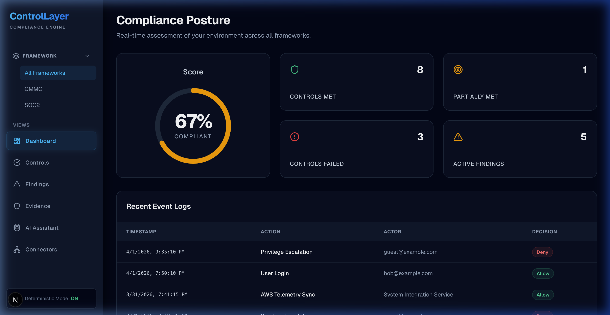
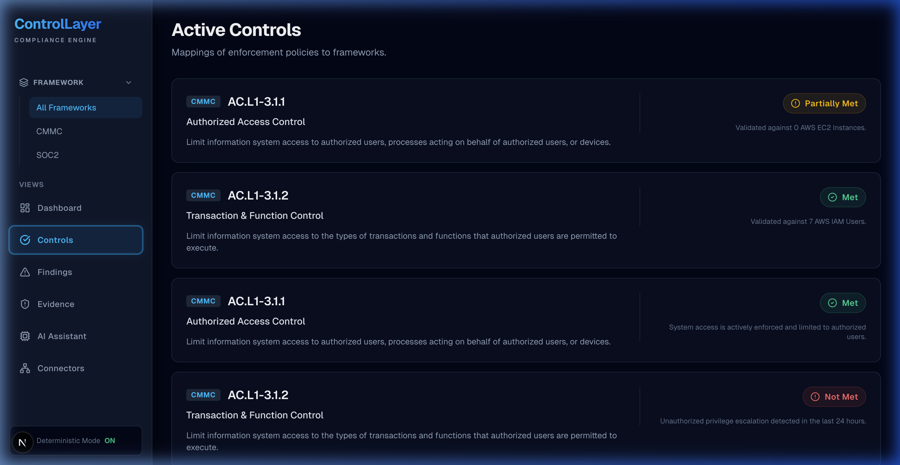
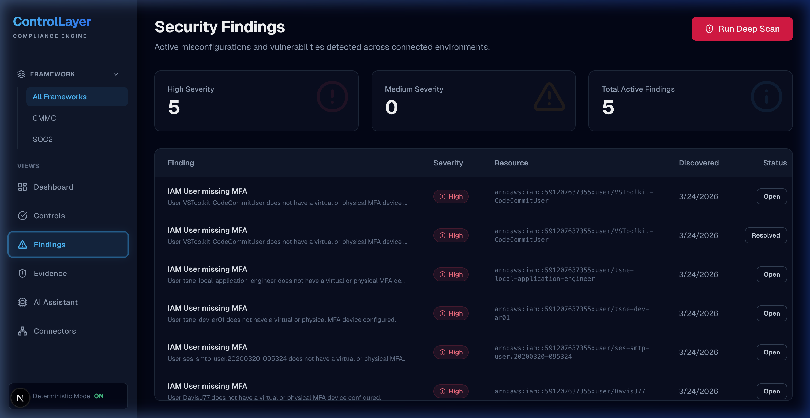
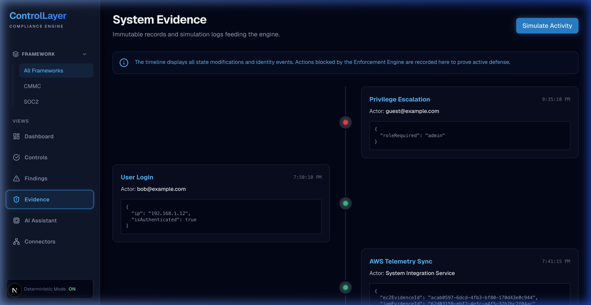
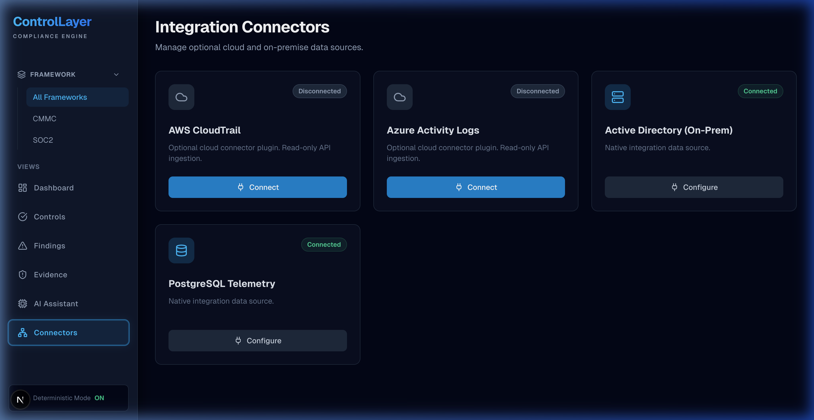
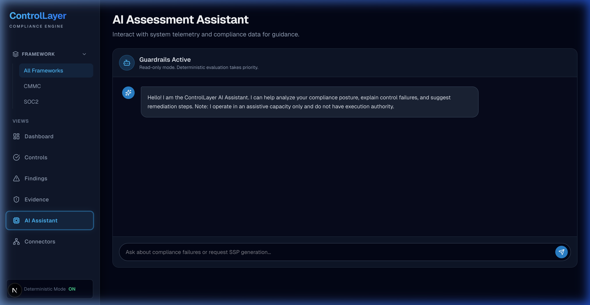

# ControlLayer: Proactive Compliance Enforcement
**Continuous CMMC Support and Automated Evidence Generation Framework**

ControlLayer is a proactive compliance engine designed to bridge the gap between static security policies and dynamic technical enforcement. By mapping live system telemetry directly to industry-standard frameworks like CMMC and SOC 2, ControlLayer provides organizations with continuous visibility, automated evidence collection, and actionable risk reduction.

---

## Why This Matters

For most organizations, compliance is a reactive, "check-the-box" exercise performed annually. This traditional approach creates several critical failure points:
* **Compliance Decay:** Security posture degrades between audits as environments drift from the baseline.
* **Manual Evidence Collection:** Security teams waste hundreds of hours manually gathering logs and screenshots for auditors.
* **Disconnected Policies:** Security controls often exist only in documents (SSPs) without real-world technical enforcement.
* **Audit Fatigue:** The stress and resource drain of audit preparation stall critical engineering innovation.

ControlLayer operationalizes compliance by making it a continuous, technical reality rather than a bureaucratic burden.

---

## What This Project Does

* **Proactive Enforcement:** Moves beyond passive monitoring by integrating with enforcement engines to flag or block unauthorized actions.
* **Automated Evidence Generation:** Automatically captures and stores immutable evidence of control performance, pulled directly from the source.
* **Continuous Posture Monitoring:** Provides a real-time compliance score that reflects the actual state of the production environment.
* **AI-Driven Remediation:** Leverages a secure, guardrailed AI analyst to help teams interpret complex control failures and suggested remediation steps.
* **Multi-Framework Mapping:** Seamlessly maps a single technical event to multiple regulatory requirements (e.g., CMMC, SOC 2).

---

## CMMC Alignment

| Feature | CMMC Domain | Why It Matters |
| :--- | :--- | :--- |
| **Real-time Enforcement** | Access Control (AC) | Helps operationalize the restriction of unauthorized transactions and functions. |
| **Immutable Timeline** | Audit & Accountability (AU) | Provides a reliable "who, what, when" for every identity action, streamlining audit evidence. |
| **MFA Detection** | Identification & Authentication (IA) | Can strengthen readiness by validating that MFA is active across managed identities. |
| **Automated Findings** | Risk Management (RM) | Maps misconfigurations to specific risks, allowing for rapid assessment and triage. |
| **System Telemetry Sync** | System & Information Integrity (SI) | Monitors system health and integrity signals from cloud and on-premise sources. |

---

## Visual Walkthrough

### 1. Unified Compliance Dashboard
The centralized command center for your compliance posture. It provides an immediate view of met vs. failed controls, active findings, and a real-time compliance score derived from live telemetry.

### 2. CMMC Control Mapping
Drill down into specific framework requirements. ControlLayer maps each policy to its technical implementation, showing which controls are actively being met and which require manual validation.

### 3. Active Findings & Remediation
A prioritized list of security gaps and misconfigurations. Each finding includes the specific resource ARN, discovery time, and severity, allowing for rapid triage and built-in remediation guidance.

### 4. Automated Evidence Timeline
Stop chasing logs. This immutable timeline records every significant system event with full metadata, providing auditors with verifiable proof of compliance without manual effort.

### 5. Multi-Cloud Integrations & Connectors
ControlLayer ingests data from where it lived. Whether it's AWS CloudTrail, Azure Activity Logs, or on-premise Active Directory, the engine normalizes telemetry for compliance analysis.

### 6. AI Security Analyst
An intelligent layer over your security data. The assistant helps GRC teams interpret control failures and provides remediation guidance based on the context of the specific environment.

---

## How It Works

ControlLayer is built on a modular architecture designed for engineering maturity:

* **Frontend:** A high-performance Next.js interface optimized for clarity and speed.
* **Telemetry Ingestion:** A pluggable connector architecture that pulls signals from cloud providers (AWS, Azure) and identity stores.
* **Policy Engine:** A deterministic mapping layer that evaluates telemetry against framework controls using pre-defined logic.
* **Evidence Store:** An immutable logging layer that preserves the "source of truth" for audit usage.
* **AI Decision Layer:** Provides context-aware analysis of failing controls while ensuring deterministic logic always takes priority.

---

## AI + Security Engineering Perspective

Artificial Intelligence is used in ControlLayer as an **assistive** force, not an autonomous agent. 

* **Deterministic Priority:** The core compliance logic is deterministic; AI is used strictly for interpretation and explanation of complex data.
* **Read-Only Context:** The AI Assistant operates in a read-only capacity, preventing it from making destructive changes to the production environment.
* **Constrained Output:** AI responses are scoped to specific findings and control mappings to ensure high-fidelity, relevant information.
* **Human-in-the-Loop:** All AI-suggested remediation steps require human review and validation before any changes are made to infrastructure.

---

## Business and Compliance Impact

* **Reduced Audit Effort:** Cuts audit preparation time significantly by having evidence pre-organized and ready.
* **Eliminated Compliance Drift:** Identifies failures the moment they occur, rather than months later during an assessment.
* **Operational Efficiency:** Frees up senior security engineers from manual data collection through automated telemetry hooks.
* **Stakeholder Confidence:** Provides leadership with a clear, data-backed metric for the organization's real-time security posture.

---

## Recruiter / Hiring Manager Takeaway

This project reflects a philosophy that **compliance should be treated as an engineering problem**. It demonstrates the ability to:
* Build practical, enterprise-minded tooling that solves real-world GRC and Security Operations pains.
* Design secure, responsible implementations of AI within sensitive security workflows.
* Architect systems that prioritize data integrity, auditability, and clear technical enforcement.
* Bridge the gap between technical infrastructure and business-level regulatory requirements.

---

## Safe Demo / Usage Notes

* **Launch the Dashboard:** Navigate to the main URL to view current compliance scores and alerts.
* **Interact with Findings:** Click into any "Finding" to see its mapping to CMMC controls and suggested fixes.
* **Review the Timeline:** Inspect the Evidence tab to see how technical events are recorded as auditor-ready evidence artifacts.
* **Test the AI Analyst:** Ask the assistant for context on a failing control or request a summary of the current environment state.

---

## Future Roadmap

* **Broader Framework Support:** mapping to more frameworks like SOC 2, NIST 800-171, and ISO 27001.
* **Automated Remediation Hooks:** Optional "one-click fix" scripts for common cloud misconfigurations.
* **Enhanced SSP Generation:** Automated generation of System Security Plans directly from the live telemetry state.
* **Pre-deployment Validation:** Validating IaC templates (Terraform/Pulumi) against compliance policies before they hit production.
